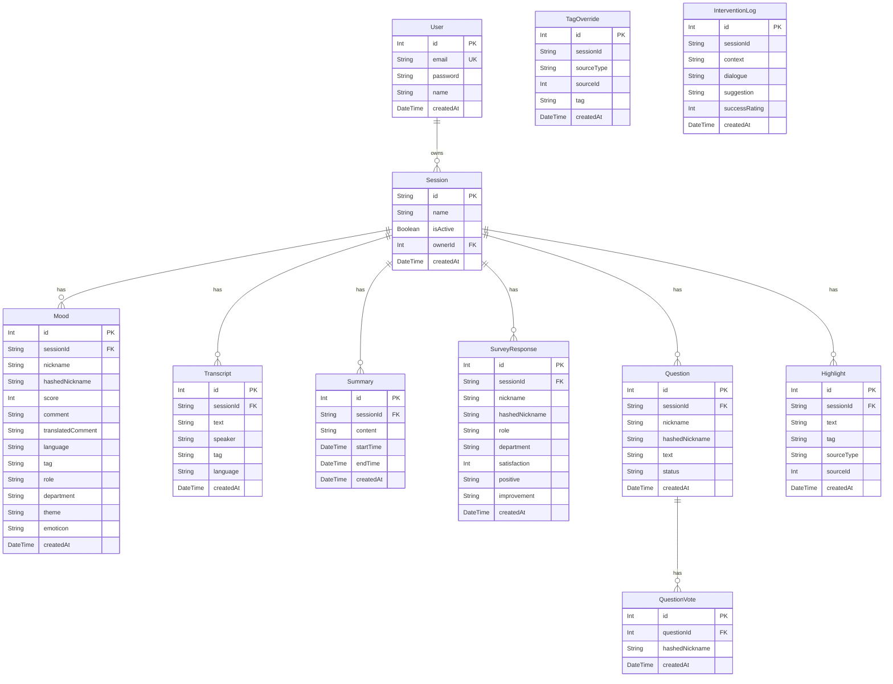

# 補佐やねん (MoodFlow) - プロジェクト構造・データベース設計

## プロジェクト概要
リアルタイムで会議参加者の感情・質問・音声文字起こしを収集・可視化し、A2A（Agent-to-Agent）によるユーモア介入と事後アンケート連携の時系列AI統合分析を行う会議支援システムです。

## 技術スタック
- **フロントエンド**: HTML5, CSS3, JavaScript (Vanilla), Chart.js, Socket.IO Client
- **バックエンド**: Node.js, Express.js (`local-server.js`), Socket.IO, Vercel Serverless Functions互換 (`api/*.js`)
- **データベース**: PostgreSQL (Supabase) + Prisma ORM (`prisma/schema.prisma`) / Google Spreadsheet（フォールバック互換）
- **AI・音声・検索**: Google Gemini API (`@google/generative-ai`), Google Cloud Speech-to-Text (`@google-cloud/speech`), Google Custom Search API
- **外部連携**: Google Slides / Drive API, Slack / Microsoft Teams Webhook, Model Context Protocol (`mcp-server.js`)

---

## ディレクトリ構成

```text
MoodFlow/
├── public/                        # フロントエンド画面・静的アセット
│   ├── index.html                 # 参加者用リアクション・質問入力画面
│   ├── presenter.html             # プレゼンター用音声ストリーミング・A2A介入アラート画面
│   ├── dashboard.html             # リアルタイム分析ダッシュボード
│   ├── admin.html                 # セッション管理・QR生成・スライド出力画面
│   ├── survey.html                # セッション後アンケート画面
│   ├── login.html                 # 管理者ログイン画面 (Supabase Auth)
│   ├── checkAuth.js               # 認証状態チェック用スクリプト
│   └── logo.png                   # サービスロゴ
│
├── api/                           # REST / SSE API ハンドラ群
│   ├── submit-mood.js             # 感情スコア・絵文字・コメント送信
│   ├── submit-transcript.js       # 文字起こしデータ登録
│   ├── get-visual-data.js         # ダッシュボード表示用データ一括取得
│   ├── stream-visual-data.js      # SSE によるリアルタイムデータストリーム配信
│   ├── humor-intervention.js      # A2A ユーモア介入提案の生成・ログ保存
│   ├── rate-intervention.js       # 介入提案の効果評価 (1〜5) 更新
│   ├── analyze-session.js         # ムード×文字起こし×要約×アンケートのAI統合分析
│   ├── get-summaries.js           # 5分ごとのAI要約一覧取得
│   ├── questions.js               # 匿名質問の投稿・一覧・投票・ステータス変更
│   ├── highlights.js              # 会議ハイライトの追加・取得
│   ├── tag-override.js            # 自動分類タグの手動変更
│   ├── submit-survey.js           # 事後アンケート送信
│   ├── get-survey.js              # 事後アンケート集計・回答取得
│   ├── cohort-stats.js            # 役職・部署・テーマ別のコホート統計
│   ├── compare-sessions.js        # 複数セッションの比較統計
│   ├── interventions.js           # ルールベースのファシリテーション提案取得
│   ├── export.js                  # CSV / JSON データエクスポート
│   ├── session.js                 # セッションの作成・開始・終了・状態取得
│   ├── my-sessions.js             # ログインユーザーのセッション一覧・管理
│   ├── generate-slides.js         # Googleスライドレポート自動生成
│   ├── cron-generate-reports.js   # 定期レポート生成用バッチAPI
│   ├── auth.js / auth-config.js   # Supabase Auth 認証補助
│   └── admin-login.js / get-session-data.js
│
├── lib/                           # サービス・インフラ層モジュール
│   ├── humor-agents.js            # A2A マルチエージェント (Host / 関西 / 関東) & RAG学習
│   ├── openai-service.js          # Gemini 統合分析・時系列照合・翻訳・タグ分類
│   ├── ai-service.js              # 5分要約・質問抽出ロジック
│   ├── scheduler.js               # 5分ごとの自動要約＆生文字起こしクリーンアップ
│   ├── search-service.js          # Google Custom Search API による話術検索
│   ├── alerts.js                  # ネガティブ急増検知 & Slack/Teams/Webhook 通知
│   ├── db.js                      # Prisma / Google Sheets データアクセス抽象化層
│   ├── prisma.js                  # Prisma Client インスタンス管理
│   ├── supabaseClient.js          # Supabase クライアント初期化
│   ├── slides-generator.js        # Google Slides 自動生成サービス
│   └── sheets.js                  # Google Sheets 読み書きサービス
│
├── prisma/
│   └── schema.prisma              # Prisma スキーマ定義 (PostgreSQL 全11モデル)
│
├── docs/                          # ドキュメント群
│   ├── features.md                # 全機能一覧
│   ├── humor-intervention.md      # A2A ユーモア介入システム仕様
│   ├── API.md                     # API仕様書
│   ├── DEPLOYMENT.md              # デプロイ＆アーキテクチャ解説
│   ├── DEPLOYMENT_RENDER.md       # Render.com デプロイ手順
│   ├── SETUP.md                   # セットアップ詳細
│   └── presentation_plan.md       # プレゼンテーション構成
│
├── gas/                           # Google Apps Script スタンドアロン版
├── local-server.js                # Express + Socket.IO メインサーバー
├── mcp-server.js                  # Model Context Protocol (MCP) サーバー
├── package.json
└── README.md
```

---

## データベース設計（Prisma / PostgreSQL）

### ER 図（Entity-Relationship Diagram）



### モデル一覧

| モデル名 | 用途 | 主なフィールド |
|---|---|---|
| `User` | 管理者・主催者アカウント | `id`, `email`, `password`, `name` |
| `Session` | 会議セッション管理 | `id` (UUID), `name`, `isActive`, `ownerId`, `createdAt` |
| `Mood` | 参加者の感情リアクション・コメント | `sessionId`, `nickname`, `hashedNickname`, `score` (-5〜+5), `comment`, `translatedComment`, `tag`, `role`, `department`, `theme`, `emoticon` |
| `Transcript` | リアルタイム音声文字起こし（5分要約後に自動削除） | `sessionId`, `text`, `speaker`, `tag`, `language` |
| `Summary` | 5分ごとのAI自動要約 | `sessionId`, `content`, `startTime`, `endTime` |
| `SurveyResponse` | セッション終了後アンケート回答 | `sessionId`, `satisfaction` (1〜5), `positive`, `improvement`, `role`, `department` |
| `Question` | 参加者からの匿名質問・要望 | `sessionId`, `text`, `status` (`open` / `answered` / `archived`) |
| `QuestionVote` | 質問への「いいね」投票 | `questionId`, `hashedNickname` |
| `Highlight` | 重要発言・ハイライト記録 | `sessionId`, `text`, `tag`, `sourceType`, `sourceId` |
| `TagOverride` | 自動付与タグの手動上書き履歴 | `sessionId`, `sourceType`, `sourceId`, `tag` |
| `InterventionLog` | A2Aユーモア介入の対話・提案・効果評価ログ（RAG学習用） | `sessionId`, `context`, `dialogue`, `suggestion`, `successRating` (1〜5) |
